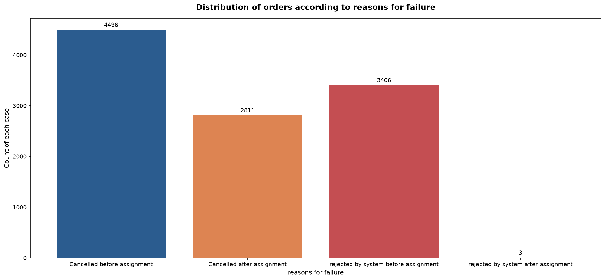
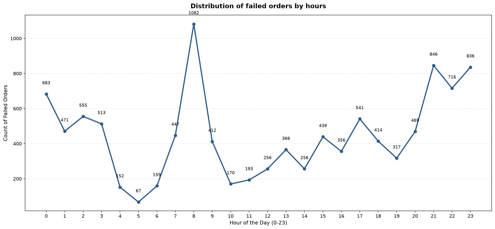
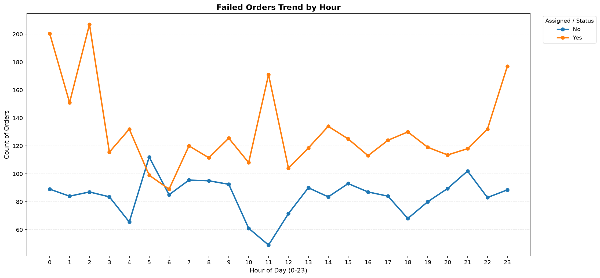
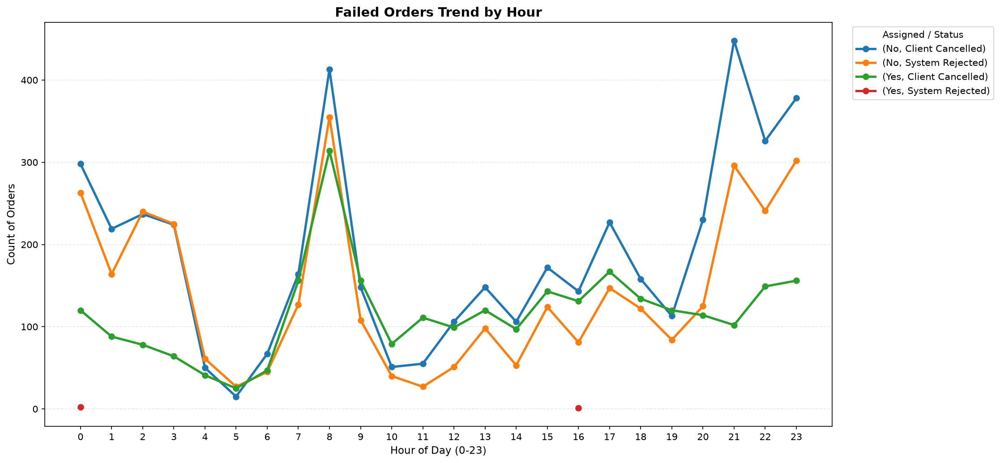
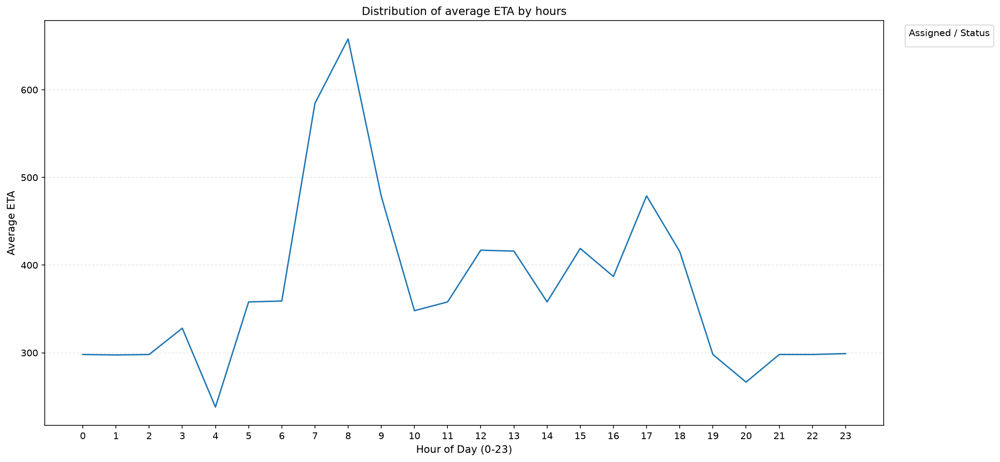
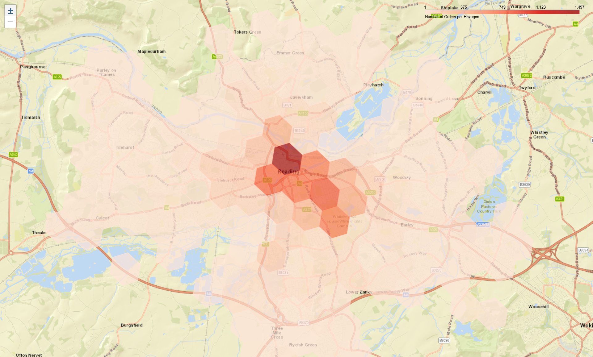

# Where Rides Fall Through: Analysis of Failed Ride Requests

Why do some ride requests never turn into completed journeys? Is it a problem with driver availability, cancellation behaviour, estimated waiting times, or simply where and when a customer places an order?

This project explores these questions through an analysis of failed ride requests. Using Python, I investigate the distribution of unsuccessful orders, identify hourly patterns, examine cancellation behaviour based on driver assignment, and uncover geographical hotspots.

The analysis also incorporates H3 hexagonal indexing and Folium to identify how geographically concentrated the recorded orders are and whether a relatively small number of areas account for most of the activity.

## Project Objectives

The analysis focuses on five main questions:

1. What are the most common reasons for unsuccessful orders, and how does driver assignment influence cancellation patterns?
2. At what times of the day do failed orders occur most frequently? Are certain failure categories more prominent during particular hours?
3. How does the time taken to cancel an order differ depending on whether a driver has already been assigned?
4. How does estimated arrival time vary throughout the day, and what relationship might it have with unsuccessful orders?
5. Can geographical clustering identify a relatively small number of areas responsible for most recorded orders?

## Dataset

The project uses the ride request matching and cancellation dataset from StrataScratch, based on a case study involving Gett, formerly known as GetTaxi.

The original data consists of two CSV files.

**data_orders.csv**

Contains order level information, including:

1. Order timestamp and unique order identifier.
2. Geographic coordinates of the order origin.
3. Estimated time before driver arrival.
4. Order status and driver assignment status.
5. Time elapsed before cancellation.

**data_offers.csv**

Contains the relationship between individual orders and driver offers.

The primary analysis uses `data_orders.csv`. The offers dataset is not merged into the analysis because the unit of analysis is the individual order. A single order can receive multiple driver offers, and joining the datasets directly would duplicate order records and inflate the resulting counts.

The orders dataset contains 10,716 records.

## Tools and Technologies

1. **Python:** Overall analysis and data processing.
2. **Pandas:** Data manipulation, grouping, aggregation and categorical analysis.
3. **NumPy:** Array operations and geographic coordinate conversion.
4. **Matplotlib:** Visualisation of failure distributions and hourly trends.
5. **H3:** Hexagonal geographical indexing and spatial aggregation.
6. **Folium:** Interactive geographical visualisation.
7. **Branca:** Colour mapping for the geographical heatmap.

## Methodology and Analysis

### 1. Distribution of Orders by Reason for Failure

The first step was to examine the distribution of unsuccessful orders based on their cancellation status and whether a driver had been assigned.

The original status codes were mapped to their corresponding descriptions:

1. Status 4 represents cancellation by the client.
2. Status 9 represents rejection by the system.
3. Driver assignment status 0 indicates that no driver was assigned.
4. Driver assignment status 1 indicates that a driver was assigned.

A cross tabulation was used to examine the relationship between cancellation status and driver assignment.

**Key Findings**

The analysis identified four failure categories:

1. Client cancellation before assignment: 4,496 orders.
2. Client cancellation after assignment: 2,811 orders.
3. System rejection before assignment: 3,406 orders.
4. System rejection after assignment: 3 orders.



The most significant finding is that approximately **74% of failed orders occurred before a driver was assigned**.

This points towards two potentially different operational challenges. Client cancellations before assignment may be associated with waiting times or unsuccessful matching, while system rejections could reflect availability or eligibility constraints.

The data identifies when orders fail, but does not independently establish the underlying reasons.

### 2. Analysing Failed Orders by Hour

To identify when unsuccessful orders occur most frequently, the order timestamps were converted into hourly categories and grouped to examine the distribution of failures throughout a 24 hour period.

The analysis also compares the different failure categories across hours to identify changes in their respective volumes.



**Key Findings**

The most prominent peak occurs at **8 AM, with 1,082 failed orders**, accounting for approximately 10% of all recorded failures.

Other notable peaks include:

1. 9 PM with 846 failed orders.
2. 11 PM with 836 failed orders.

Another interesting pattern emerges between 8 PM and 4 AM. This period accounts for 5,089 failed orders, approximately 47.5% of the entire dataset.

The lowest activity occurs during the early morning hours, particularly around 5 AM, when only 67 failures are recorded.

The morning peak could reflect increased demand during commuting hours, while the evening concentration may be associated with transportation demand later in the day.

The following visualisations provide additional perspectives on hourly failures, separating the orders according to driver assignment and failure category.





These charts show the volume and category composition of failed orders, not the actual probability of failure at a particular hour. A comparison with successful orders would be necessary to calculate hourly failure rates.

### 3. Cancellation Time With and Without Driver Assignment

The next step examines how long customers wait before cancelling an order, comparing orders where a driver had been assigned with those where no driver assignment had occurred.

Cancellation durations were grouped by hour and driver assignment status.

The median was used instead of the mean because it is less sensitive to unusually high cancellation times and provides a more representative measure of a typical cancellation.

Across most hours, the median cancellation time is higher when a driver has already been assigned.

Some examples include:

1. At midnight, the median cancellation time is 200.5 seconds with a driver assigned, compared with 89 seconds without an assignment.
2. At 11 PM, the corresponding values are 177 seconds and 88.5 seconds.

This suggests that customers generally wait longer when a driver has already accepted the request, potentially because they have greater confidence that the journey will proceed.

An important methodological distinction is that this analysis uses median aggregation rather than formally identifying and removing outliers. The median reduces the influence of extreme observations, but does not eliminate them from the dataset.

### 4. Analysing Estimated Arrival Times

Estimated arrival time provides another perspective on the customer experience.

The analysis groups the available ETA values by hour and calculates a representative ETA for each hour.



**Key Findings**

The morning hours show a particularly noticeable increase in estimated arrival times.

1. At 8 AM, the recorded ETA summary reaches 658 seconds.
2. At 7 AM, it reaches 584.5 seconds.
3. The lowest value occurs at 4 AM, at 238 seconds.

The morning ETA increase closely coincides with the 8 AM peak in failed orders.

This suggests a possible relationship between longer estimated waiting times and unsuccessful ride requests. During periods of increased demand, longer ETAs may make customers more likely to abandon their requests.

The dataset contains only 2,814 non missing ETA values out of 10,716 records. Consequently, these figures describe the subset of orders with available ETA information rather than the entire dataset.

### 5. Geographical Analysis Using H3 Hexagons

The final section explores the geographical distribution of failed orders using the H3 hierarchical hexagonal indexing system.

The original latitude and longitude coordinates were converted into H3 cell identifiers at resolution 8.

Each geographical cell was then assigned an order count, and the resulting cells were sorted from highest to lowest volume.

A cumulative percentage was calculated to determine how many of the busiest hexagons were needed to account for at least 80% of all recorded orders.

**Key Findings**

The analysis identified that just **24 of approximately 140 occupied hexagons account for 80.57% of all recorded orders**.

This represents roughly 17% of the occupied geographical cells.

Some additional observations:

1. The busiest individual hexagon contains 1,497 orders, representing approximately 14% of the entire dataset.
2. The highest concentration of orders is clustered around central Reading, UK.
3. The distribution suggests that recorded failures are not evenly spread across the geographical service area.


The analysis uses Folium to generate an interactive geographical map, with hexagons coloured according to the number of orders within each cell.



This analysis highlights how geographical clustering can reveal operational concentration that may not be immediately apparent from conventional charts.

## Key Insights and Business Implications

Bringing the different findings together reveals a few interesting patterns.

**1. Most failures occur before driver assignment.**

Approximately 74% of unsuccessful orders never reach the stage where a driver has been assigned. This makes the driver matching process an important area for further investigation.

**2. The morning commute is a particularly challenging period.**

The highest number of failures occurs at 8 AM, which coincides with the peak in estimated arrival time. This suggests that longer estimated waiting times may contribute to increased cancellations.

**3. Driver assignment influences cancellation behaviour.**

Customers generally wait longer before cancelling when a driver has already been assigned. This may indicate that successful assignment provides some reassurance about the likelihood of completing the journey.

**4. Failed orders are geographically concentrated.**

Only 24 resolution 8 hexagons account for more than 80% of recorded orders. This suggests that operational improvements could potentially have a greater impact when focused on high concentration areas rather than distributed uniformly across the service area.

**Potential Business Recommendation**

A reasonable area for further investigation would be driver availability and matching performance around central Reading during the 7 AM to 9 AM period.

Targeted driver incentives or improvements to the matching process could be tested in these locations and time windows.

However, the current dataset does not contain the number of available drivers or successfully completed orders, so the supply and demand explanation remains a hypothesis rather than a confirmed cause.

## Limitations and Further Exploration

Although the analysis reveals several useful patterns, there are some limitations worth acknowledging.

1. The dataset contains failed orders rather than a complete record of all successful and unsuccessful requests. Therefore, failure rates cannot be calculated reliably.
2. The timestamps contain time of day rather than complete calendar dates. This prevents analysis of weekday, weekend or seasonal variations.
3. The hourly failure charts primarily show absolute counts. A normalized comparison of failure category proportions would provide a more complete understanding of how the composition of failures changes throughout the day.
4. Median cancellation times reduce sensitivity to extreme values, but formal outlier detection and removal have not been implemented.
5. ETA analysis is limited to the 2,814 records with available ETA values.
6. The dataset does not include sufficient information about available drivers or matching attempts to establish the precise causes of unsuccessful orders.

Future analysis could incorporate successful ride records, driver availability, offer acceptance rates and more detailed temporal information to investigate these patterns further.

## How to Run the Project

The project was developed using Jupyter Notebook.

Install the required libraries:

```bash
pip install numpy pandas matplotlib folium h3 branca
```

Ensure that `data_orders.csv` is available in the project directory.

Open the notebook and execute the cells sequentially.

The notebook generates the analytical charts and an interactive geographical map saved as `map.html`.

The chart images are included in the repository root directory for convenient viewing within this README.

Open `map.html` in a web browser to explore the geographical distribution of recorded orders.

## Data Attribution

Original case study: Gett, formerly known as GetTaxi.

Dataset source: StrataScratch, DoorDash.


